# Forge+

**A modern, 3D map editor for Marathon 2: Durandal, Marathon Infinity and Aleph One, built on the Unity engine.**

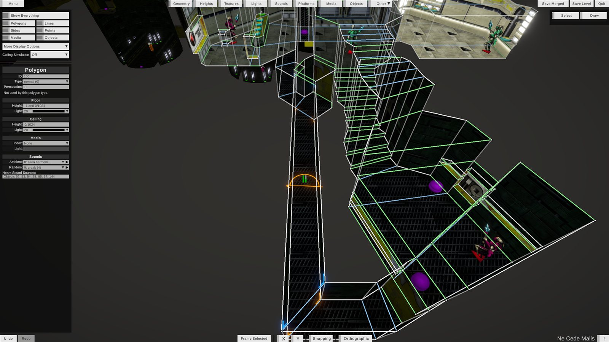

Forge+ shows your level the way the game does, with its textures, lights, liquids, sprites and sounds. You can fly through it in 3D or look straight down on it from above, and edit it directly in the view. It reads and writes the original Marathon 2/Infinity map format, along with amended resource and new Aleph One data. Anything it saves still loads in the original Marathon 2 and Infinity, unless you choose to use features that only Aleph One supports, and those are always labeled.

Forge+ was originally written by Richard L Harrington. It builds on ideas from [Weland](https://github.com/treellama/weland), an open-source map editor by Gregory Smith (treellama), and takes its understanding of the game data from the [Aleph One](https://github.com/Aleph-One-Marathon/alephone) engine.

---

## Contents

- [Getting Forge+](#getting-forge)
- [Quick start](#quick-start)
- [The screen at a glance](#the-screen-at-a-glance)
- [Moving around the level](#moving-around-the-level)
- [Selecting things](#selecting-things)
- [Modes](#modes)
  - [Geometry](#geometry) · [Heights](#heights) · [Textures](#textures) · [Lights](#lights) · [Sounds](#sounds) · [Platforms](#platforms) · [Media](#media) · [Objects](#objects)
  - Other: [Level](#level) · [Map](#map) · [Annotations](#annotations) · [Terminals](#terminals)
- [Snapping, axis locks and number fields](#snapping-axis-locks-and-number-fields)
- [Undo and redo](#undo-and-redo)
- [Errors panel](#errors-panel)
- [Display options](#display-options)
- [Files, plugins and scripts](#files-plugins-and-scripts)
- [Saving](#saving)
- [Compatibility: Marathon 2, Infinity and Aleph One](#compatibility-marathon-2-infinity-and-aleph-one)
- [Settings](#settings)
- [Input reference](#input-reference)
- [Tips and tricks](#tips-and-tricks)
- [Known gaps and planned work](#known-gaps-and-planned-work)
- [Building Forge+ yourself](#building-forge-yourself)

---

## Getting Forge+

Download a build for your platform from the [Releases page](https://github.com/deramscholzara/ForgePlus/releases), decompress it, and run it as you would any other program.

> [!WARNING]
> **Mac users:** the built-in Archive Utility corrupts the app when it decompresses it. Use another decompressor instead, such as [Keka](https://www.keka.io/en/).

## Quick start

1. Forge+ opens with the **Menu** showing its **Files** tab.
2. Click **Find In Directory** and pick your scenario's folder (for example, your Marathon Infinity folder). Forge+ finds its Maps, Shapes, Physics and Sounds files, and its Plugins and Scripts folders. You can also pick each file yourself with its **Select** button.
3. Choose a level in the list and click **Load Level**. To start from scratch instead, click **New Map** (or **New Level**, to add one to the loaded map).
4. Close the menu (**Close**, or <kbd>Esc</kbd>), and fly around with the mouse and <kbd>W</kbd> <kbd>A</kbd> <kbd>S</kbd> <kbd>D</kbd>.
5. Pick a mode from the header bar (Geometry, Heights, Textures...), click things to inspect them, and edit them in the left-hand inspector or directly in the view.
6. Save with **Save Merged** (the whole map file) or **Save Level** (just this level, as its own map file).

Forge+ remembers your file paths, so they load again the next time you start it.

---

## The screen at a glance

| Area | What's there |
|---|---|
| **Header bar** (top) | **Menu** toggle · the **mode** tabs and the **Other** menu · **Save Merged**, **Save Level** and **Quit** |
| **Left column** | **Visibility** toggles, **More Display Options** and **Culling Simulation** · the **inspector** for what's selected (in Map, Annotations and Terminals modes, that mode's own panel) |
| **Right column** | The **tool** choice for modes with more than one tool (Select / Draw, or Select / Paint) · the mode's **palette** (textures, lights, media, sounds, heights, platforms, polygons or text styles) |
| **Center** | The 3D view. The **Menu**, the **Errors** panel and the **terminal preview** open here |
| **Bottom bar** | **Undo** / **Redo** · **Frame Selected** · **X** / **Y** axis locks · **Snapping** · **Orthographic** · the open level's name · the **Errors** toggle (**!**) |

Every field, button and tab has a tooltip, so hover over anything to learn what it does. Grayed-out fields show data that Forge+ can't edit yet, or can't edit in the current situation. In that case, a caption or tooltip usually says why.

**Visibility toggles:** **Show Everything**, **Polygons**, **Lines**, **Sides**, **Points**, **Media** and **Objects** control what's drawn in the view. Hidden things can't be clicked, so these toggles double as selection filters. Lines and Points only apply in Geometry mode, and some modes force a toggle on (for example, Media mode always shows media).

In Geometry mode, line colors tell you what kind of line you're looking at:

| Color | Meaning |
|---|---|
| White | One-sided (a solid wall with a polygon on only one side) |
| Light blue | Two-sided, with the same floor and ceiling heights on both sides |
| Light green | Two-sided, with different heights on each side |
| Red | Selected |

---

## Moving around the level

Forge+ has two views: a free-flying **perspective** camera, and a **top-down** (orthographic) view, like a traditional map editor. Toggle between them with <kbd>O</kbd> or the **Orthographic** button.

| Input | Perspective view | Top-down view |
|---|---|---|
| <kbd>W</kbd> / <kbd>S</kbd> | Move forward / back | Move up / down the screen |
| <kbd>A</kbd> / <kbd>D</kbd> | Move left / right | Move left / right |
| <kbd>E</kbd> / <kbd>Q</kbd> | Move up / down | Raise / lower the camera (whatever is above it isn't drawn) |
| Hold <kbd>Shift</kbd> | Move faster | Move faster |
| Hold **right mouse** and move | Look around | (Locked) |
| **Mouse wheel** | Move forward / back | Zoom |
| **Middle mouse** drag | Pan (grab the level) | Pan |
| Hold <kbd>Space</kbd> + **left mouse** drag | Pan | Pan |
| <kbd>F</kbd> or **Frame Selected** | Frame the selection | Frame the selection |

**Frame Selected** makes what it frames flash green. With nothing selected, it frames the last thing you selected, or else the nearest object or polygon.

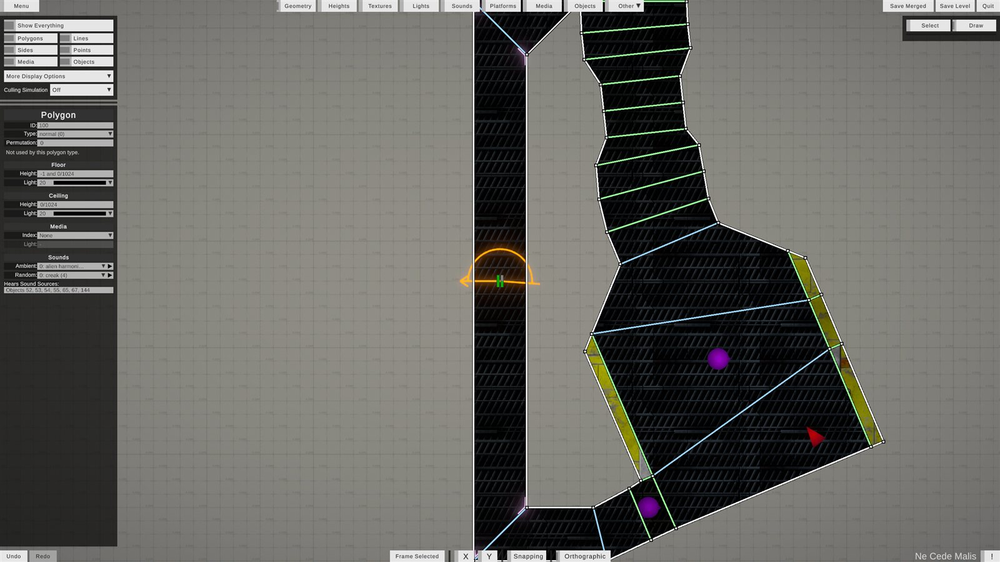

---

## Selecting things

- **Click** to select. **Shift+click** adds to or removes from the selection.
- **Click empty space** to deselect everything (except in Level mode, where the level stays selected).
- **Drag from empty space** (with the Select tool, in Geometry, Heights, Objects, Sounds and Annotations modes) to draw a **selection rectangle**:
  - By default, only things **wholly inside** the rectangle are selected.
  - Hold <kbd>Ctrl</kbd> (<kbd>Cmd</kbd> on Mac) to select everything the rectangle **touches**.
  - Hold <kbd>Shift</kbd> to **add** to the existing selection.
  - Press <kbd>Esc</kbd> to cancel and restore the previous selection.
  - In perspective, the rectangle only picks things within the distance where points fade out. In the top-down view, it picks everything in view.
- **Switching modes keeps the selection meaningful.** For example, select a polygon in Geometry mode, switch to Lights mode, and that polygon's light is selected.
- Selecting more than one thing shows no inspector yet. Multi-selection is used for moving and deleting things together.
- **Press <kbd>Delete</kbd> or <kbd>Backspace</kbd>** to delete or clear what's selected, as one undoable step. What that means depends on the mode:

  | Mode | Delete Selected |
  |---|---|
  | Geometry | Deletes the selected polygons, points and lines (see [Deleting geometry](#geometry)) |
  | Objects, Annotations | Deletes the selected objects or annotations |
  | Sounds | Clears the selected polygons' ambient and random sounds |
  | Media | Removes the media from the polygon it was selected in |
  | Lights | Sets the surface the light was selected on to light 0 |
  | Platforms | Turns the selected platforms back into normal polygons |
  | Textures | Clears the textures of the selected surfaces (the face you clicked, and the same face of the rest of the selection). A control panel's main texture is set by its panel type, so it isn't cleared |

---

## Modes

Pick a mode from the header bar. The everyday modes have their own tabs: **Geometry**, **Heights**, **Textures**, **Lights**, **Sounds**, **Platforms**, **Media** and **Objects**. The modes you'll use less often are in the **Other** menu at the end: **Level**, **Map**, **Annotations** and **Terminals**. The Other button stays checked while one of those is open. If the window is too narrow for every tab, scroll the tabs sideways with the mouse wheel.

Each mode focuses on one kind of map data and shows the matching inspector and palette. Some modes have more than one **tool**:

| Mode | Tools |
|---|---|
| Geometry | **Select**, **Draw** |
| Textures, Lights, Media, Sounds, Heights | **Select**, **Paint** (apply the palette's chosen swatch to whatever you click) |
| Platforms, Objects, Annotations, Level, Map, Terminals | Select only |

### Geometry

Shape the level: polygons, lines, sides (walls) and points.

**Select tool**

- **Drag a point** (or its vertical "pole") to move it. If it's selected, everything selected moves with it.
- **Drag a line** to move both of its ends.
- **Drag a selected polygon's floor or ceiling** (in perspective) to raise or lower it. Every selected polygon's matching surface moves by the same amount.
- **Drag a selected polygon** in the top-down view to move it across the level.

**Draw tool**

- **Extrude a line into a new polygon:** drag a line that has a polygon on one side only. A copy of the line follows the pointer, and a new polygon fills the gap when you let go. It copies its neighbor's floor, ceiling, lights and wall textures.
- **Draw a new line from a point:** drag from a point. The line ends at a new point, or snaps to an existing point within the **Point Snapping Distance** setting.
  - **Split a polygon:** draw a line from one corner of a polygon to another, non-adjacent, corner. (Platform polygons can't be split.)
  - **Close a polygon:** when a line completes a loop, Forge+ fills it with a new polygon automatically. The loop must be convex, have at most 8 corners and have nothing inside it.
- **Draw a new line from empty space:** click empty space, then press again and drag. The line starts at a new point where you pressed. It's drawn at the floor height of the polygon whose corner is nearest (or at 0, in an empty level). Lines that don't touch any polygon are shown at the lowest floor of the polygons their chain of lines reaches (or at 0).
- **Fill a loop of lines:** any loop of lines that could become a polygon shows its future floor in see-through cyan. Double-click it to fill it. The new polygon copies a polygon at its corners. If there isn't one, it gets a plain floor at 0 and a ceiling one world unit above, with the first plain wall texture of the environment (skipping control panel and liquid textures) and the first light.
- **Add a point to a line:** double-click the line. Every polygon along that line gains the new corner (each polygon can have at most 8).
- Dragging a selected floor or ceiling still changes its height in this tool.

**Deleting geometry:** in Geometry mode, press <kbd>Delete</kbd> or <kbd>Backspace</kbd> to delete the selected polygons, points and lines, as one undoable step.
- **A deleted polygon** leaves its lines and points behind, empty. Its objects and annotations are deleted with it, and its neighbors' faces toward it become walls.
- **A deleted point** is taken out of its chain of lines instead of leaving a gap. Its neighbors are joined across where it was, and a polygon left with fewer than three corners is deleted too. Objects and annotations in the polygons that shrink are kept inside them.
- **A deleted line** goes by deleting the points at both of its ends.
- Points left with no lines are removed, and the selection is cleared afterward.

**Keeping geometry valid:** Forge+ won't let a move or a new line make a polygon concave, inside-out or self-crossing, or make a line longer than 32 world units. A note in the view explains why it stopped. Hold <kbd>Shift</kbd> to allow it anyway.

**Knock-on fixes happen automatically.** For example:
- A line dragged to zero length collapses into a single point.
- Objects and annotations left outside their polygon are moved back inside it.
- Sides are added or removed as height changes reveal or hide walls.

**Inspectors**

| Inspector | What you can edit |
|---|---|
| **Polygon** | Type (choosing *Platform* turns it into a platform with S'pht door settings; choosing another type removes the platform), permutation, floor and ceiling heights and lights, media, ambient and random sounds |
| **Line** | Solid, Decorative *(Aleph One only)*. Buttons to select or add its front and back sides |
| **Side** | Fill Opening, ambient delta, control panel settings (type, target, flags), lights for each texture layer |
| **Point** | X and Y position |

If a line has no side data on a face, clicking that wall shows a **placeholder side** inspector. To create the side, use the Line inspector's **Add Side** buttons.

> [!TIP]
> Hold <kbd>Ctrl</kbd> while moving points, lines or polygons to drag their textures along with them, so the textures stay aligned.

### Textures

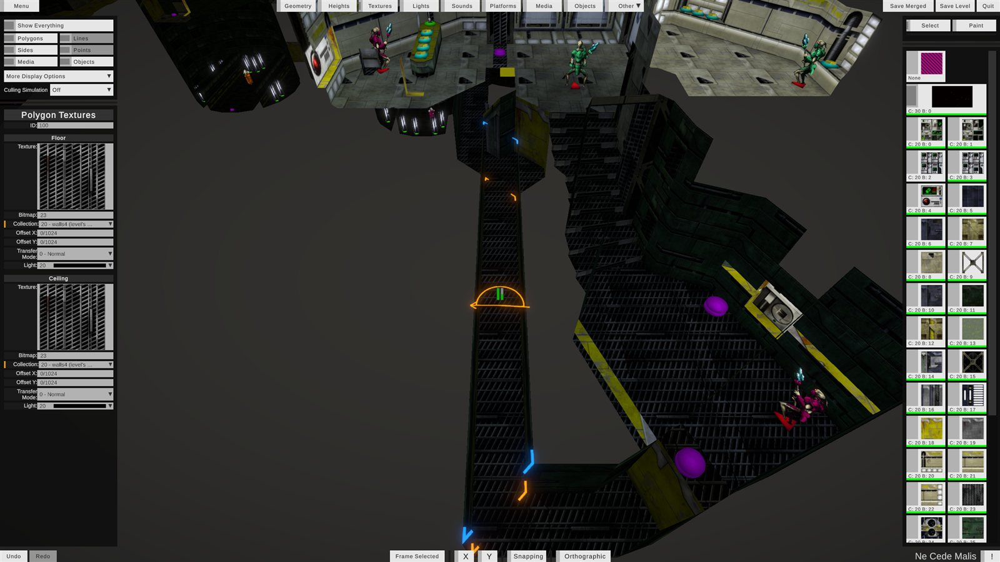

Assign and align textures on floors, ceilings and walls.

- **Click** a surface to select it. Its texture is highlighted in the palette.
- **Drag** a surface to slide its texture.
  - Hold <kbd>Ctrl</kbd> to also move the textures on neighboring surfaces that continue the same bitmap.
  - Hold <kbd>Alt</kbd> as you start dragging a wall with a transparent layer to drag that layer instead.
- **Arrow keys** nudge the selected surface's texture by 1/128 world unit (or to the next 1/32 with Snapping on). <kbd>Ctrl</kbd>+arrows also nudge the continuing textures.
- **Alt+click** a surface to align its texture to the selected surface.
- **Paint tool:** click a surface to apply the palette's texture. On a wall with a transparent layer, Forge+ asks which layer to paint.
- The inspector also sets each surface's collection, bitmap, transfer mode, offsets and light.

A control panel's main texture comes from its panel type, so you change it in the Side inspector instead.

### Lights

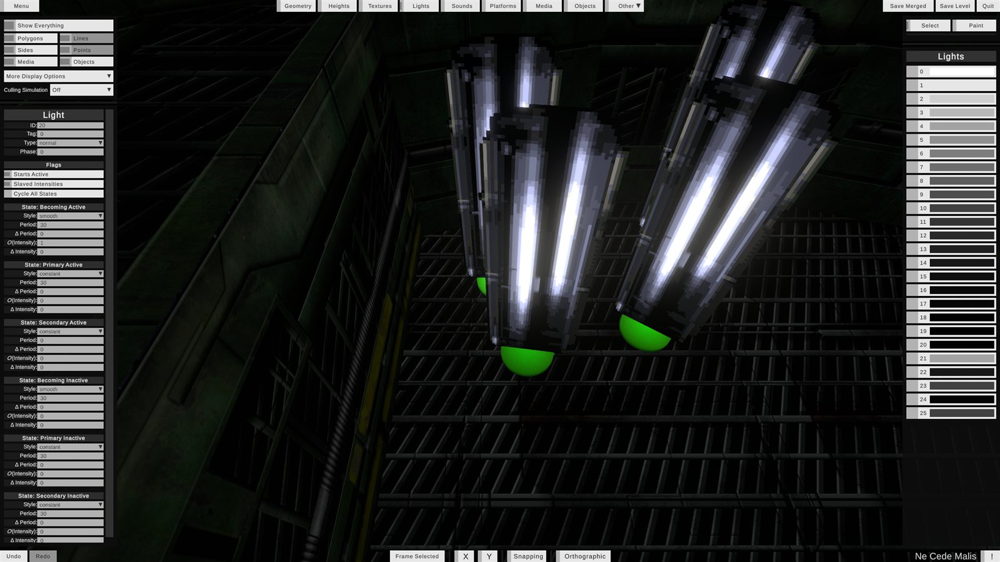

- **Click** any floor, ceiling or wall to select its light.
- **Paint tool:** click surfaces to give them the palette's light.
- The palette's swatches preview each light's current intensity.
- **Inspector:** tag, type, phase, flags, and all six states (style, period, intensity and their random deltas). Changing the type offers to reset the states to that type's defaults.

### Media

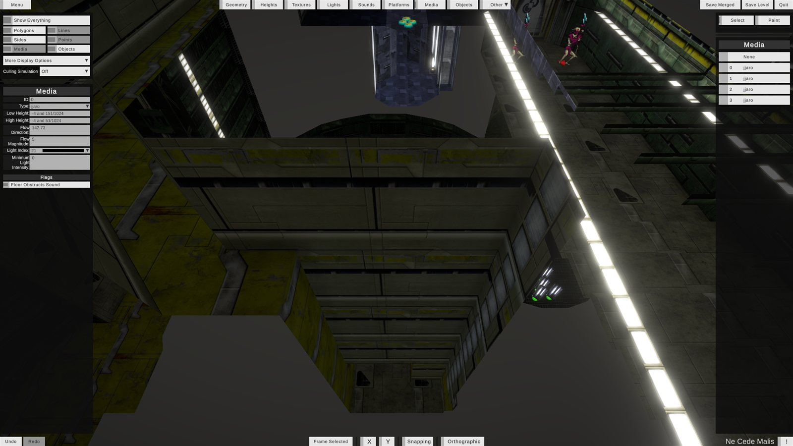

Liquids such as water, lava and sewage.

- **Click** a polygon's floor, ceiling or media surface to select its media. Walls can't be clicked in this mode.
- **Paint tool:** apply the palette's media to polygons, or paint **None** to remove it.
- **Inspector:** type, low and high heights, flow direction and strength, light, minimum light intensity, Floor Obstructs Sound.

### Sounds

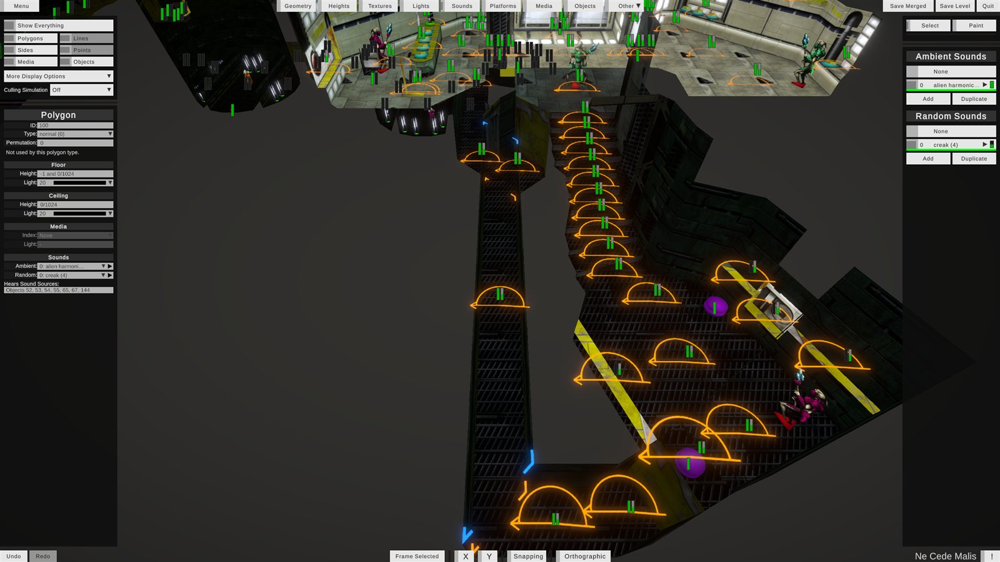

- **Click** a polygon's floor or ceiling to see its ambient and random sounds, and which sound-source objects it hears. Walls and objects can't be clicked in this mode, and the selection rectangle picks polygons.
- **Paint tool:** give clicked polygons the sounds chosen in the palette.
- The palette lists the level's **Ambient Sounds** and **Random Sounds**. Each one has a ▶ play button, and you can **Add** or **Duplicate** entries. Select an entry to edit its sound, volume, period, pitch and direction, and see where it plays, or **Delete** it.
- To select, move or delete sound-source objects, use Objects mode.
- **Listen to the level:** turn on **More Display Options → Play Level Audio** (needs a Sounds file), then move the camera into a polygon to hear what the game plays there: that polygon's ambient and random sounds, and the sound sources it hears.

> [!NOTE]
> The original Marathon 2 and Infinity hold 64 ambient and 64 random sounds per level. Entries beyond that are marked *Aleph One only*.

### Heights

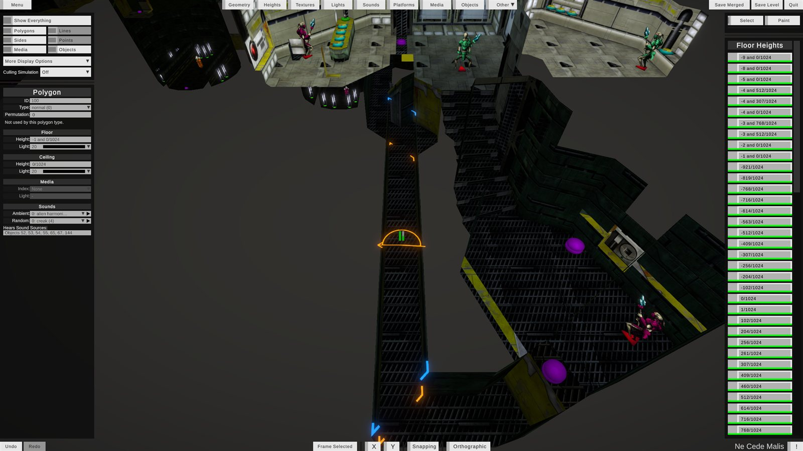

Manage floor and ceiling heights as a palette.

- **Click** a floor or ceiling to select its polygon and highlight its height in the palette.
- **Drag** a floor or ceiling up or down. All selected polygons follow.
- **Paint tool:** apply the palette's height to the floors or ceilings you click.
- Platform floors and ceilings can't be clicked in this mode. Their heights are set in the Platform inspector.
- Add new heights with **Add Floor Height** / **Add Ceiling Height**, or type over a swatch's value. If that height is in use, Forge+ asks whether to **Change All** polygons using it, or **Add New Height**.

### Platforms

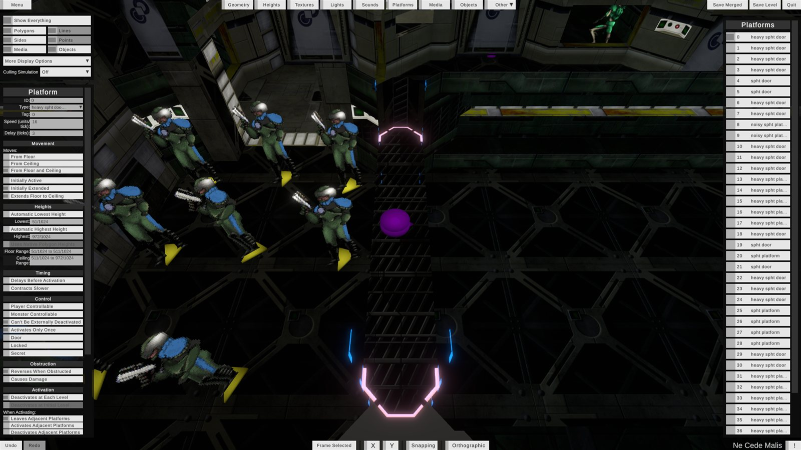

Doors, lifts and crushers.

- **Click** any part of a platform to select it, or pick it from the list on the right (this also frames it).
- **Inspector:** type, speed, delay, movement, heights, timing, who can control it, what happens when it's obstructed, and what it activates or deactivates.
- To make a new platform, select a polygon in Geometry mode and set its **Type** to *Platform*.

**Simulating platforms:** you can watch platforms move in Forge+, in any mode. Simulation is never saved to the map.

| Input | Action |
|---|---|
| <kbd>Tab</kbd> | Use the door or switch in front of the camera, like the player's action key |
| <kbd>Shift</kbd>+<kbd>Tab</kbd> | Start or stop the selected platforms (or the platforms of selected polygons, lines, sides or objects) |
| <kbd>Ctrl</kbd>+<kbd>Tab</kbd> | Pretend something is blocking the selected platforms |

The Platform inspector's **Simulation Actions** do the same.

### Objects

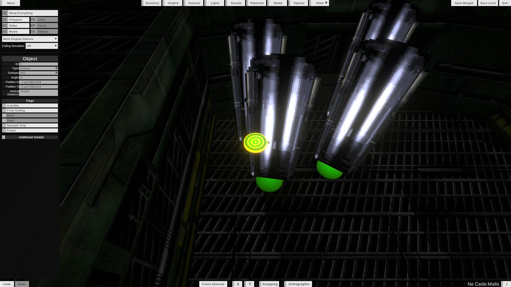

Monsters, items, scenery, player starts, goals and sound sources.

- **Click** an object to select it. Clicks pass through walls, floors and ceilings, so you can pick objects behind them. **Drag** to move it (with any other selected objects) into whichever polygon it ends up over.
  - With Snapping on, or while holding <kbd>Ctrl</kbd>, an object keeps its height above the floor (or below the ceiling, for ceiling objects). Otherwise it keeps its height in the world.
- **Inspector:** type, subtype, angle, position, height, flags, and (for sound sources) the sound, its volume and its light.
- **With nothing selected,** the inspector shows the level's **Object Placement** settings for items and monsters: initial, minimum and maximum counts, random counts and chances, and whether they reappear in random locations.

### Annotations

The text labels shown on the in-game map.

- The left panel lists every annotation. Click one to select and frame it.
- With an annotation selected, click a polygon in the view, or in the polygon list on the right, to link the annotation to it.
- Edit its text (Mac Roman characters only) and its X/Y position.

### Level

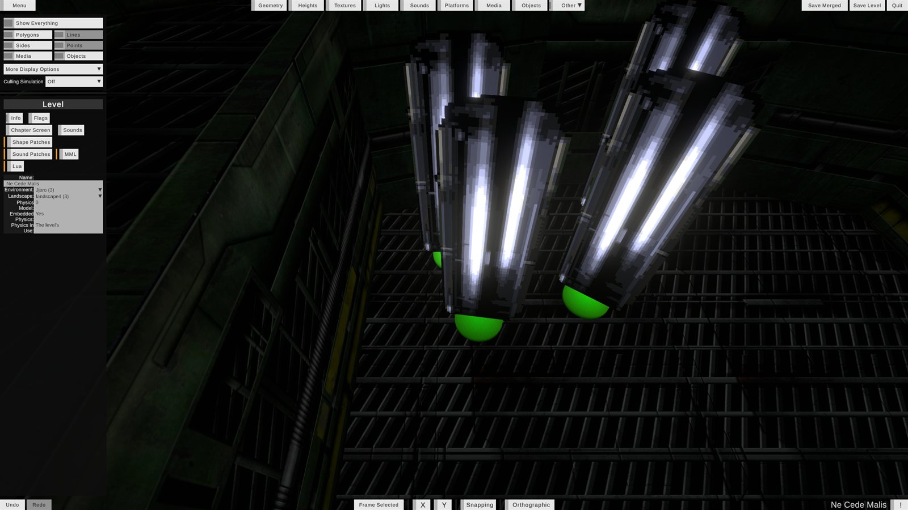

Level-wide settings, in tabs:

| Tab | Contents |
|---|---|
| **Info** | Name, environment and landscape. When changing these, you can choose to move the textures along, or keep them *(Aleph One only)*. Physics information |
| **Flags** | Game types, environment flags (vacuum, magnetic, rebellion, low gravity) and mission types. Marathon 1 flags *(Aleph One only)* |
| **Chapter Screen** | Whether the level's chapter screen is shown (and saved) |
| **Sounds** | How many ambient and random sounds the level has |
| **Shape Patches**, **Sound Patches**, **MML**, **Lua** *(Aleph One only)* | Viewable, and kept and saved as they are |

### Map

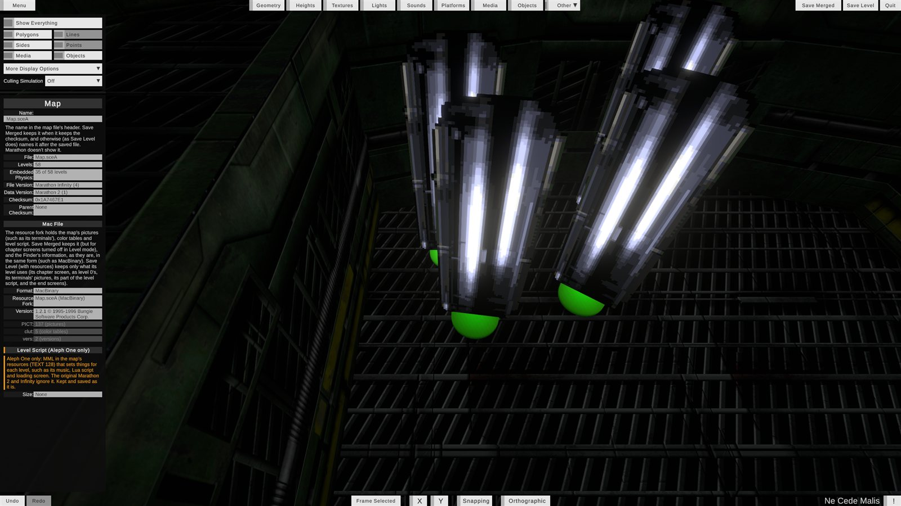

Information about the map file itself: its name (editable), file and data versions, checksums, how many levels have embedded physics, and its Mac resource fork contents (pictures, color tables, level script).

### Terminals

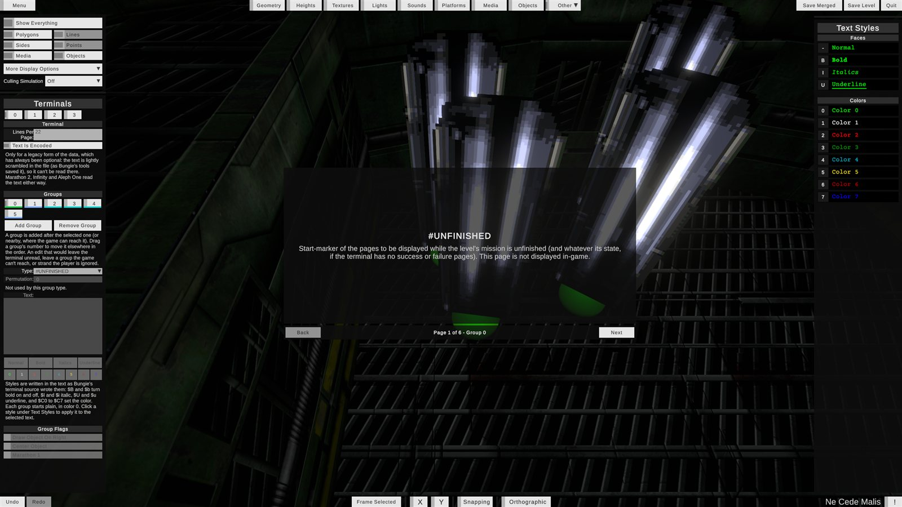

- Pick a terminal and a group from the left panel, or click a terminal's wall in the view. Forge+ previews it as the game shows it, with **Back** / **Next** page buttons.
- **Edit a group's** type, permutation, text and object placement. **Add Group** / **Remove Group**, and drag a group's number to reorder it.
- **Text styles:** select some text and click a face (bold, italic, underline) or one of the eight colors in the palette on the right to apply it. This inserts the `$B`, `$I`, `$U` and `$C0`–`$C7` codes.
- **Text Is Encoded** saves the terminal's text lightly scrambled, as Bungie's tools did. This is optional: Marathon 2, Infinity and Aleph One read the text either way.
- The panel is grayed out when the level has no terminals.
- Forge+ ignores edits that would break a terminal, such as leaving the player stranded or leaving a group unreachable.

---

## Snapping, axis locks and number fields

- **Snapping** (bottom bar): moves positions and heights in steps of 1/16 world unit, and angles, volumes and similar values in steps of 5. Hold <kbd>Alt</kbd> to invert it temporarily.
- **Axis locks:** press <kbd>X</kbd> or <kbd>Y</kbd> (or use the bottom-bar buttons) to restrict drags to one axis. Locking one unlocks the other.
- **Number fields:** type a value, or **drag a field's label** left and right (or up and down) to scrub its value. Snapping applies here too.
- **World units:** heights and positions are shown in world units, such as `-1 and 512/1024`. Turn on **Display World-Units as Improper Fractions** in Settings to show them as `-512/1024` instead.

## Undo and redo

Every edit can be undone, including selection changes and the knock-on fixes an edit makes.

- **Undo:** <kbd>Ctrl</kbd>+<kbd>Z</kbd> (<kbd>Cmd</kbd>+<kbd>Z</kbd>), or the **Undo** button.
- **Redo:** <kbd>Ctrl</kbd>+<kbd>Y</kbd>, <kbd>Ctrl</kbd>+<kbd>Shift</kbd>+<kbd>Z</kbd> (<kbd>Cmd</kbd>+<kbd>Shift</kbd>+<kbd>Z</kbd>), or the **Redo** button.
- A whole drag, or a burst of typing, is one undo step. Hover over the buttons to see which change they'll undo or redo.
- The history holds 50 steps by default. Change this with **Undo Steps** in Settings (1–10,000).

## Errors panel

The **!** button in the bottom-right corner flashes red when the level has problems. Click it to open the Errors panel, which lists them:

- **Geometry:** inside-out, flat or concave polygons, crossing edges, zero-length or over-long lines, redundant corners, points with no lines (older maps may have these on purpose), points nearly touching lines, objects or annotations outside their polygons, and too many map entries.
- **Terminals:** missing or unreachable groups, sections running into each other, teleports to missing levels or polygons, and control panels pointing at missing terminals.

Use **Show** to select and frame a problem, and **Fix** (or **Fix All**) for problems Forge+ can fix automatically. Filter the list with **All**, **Auto-Fixable** and **Standard**, and turn **Show Warnings** on or off.

## Display options

The **More Display Options** dropdown (under the visibility toggles) has:

| Option | Effect |
|---|---|
| **Grid** | Shows a grid in the top-down view |
| **Simple Visuals** | Draws every surface with a plain grid texture, so shapes are easier to see |
| **Diagnostic Visuals** | Shows concave polygons in red and overlapping volumes in faint yellow |
| **Show Lighting** | Shows the level's lighting |
| **Sprite Previews** | Shows sprites for objects |
| **Clip Platform Sides** | Clips the walls of platforms the way the game does |
| **Show Invalid Sides** | Shows the walls of lines that have no side data for them |
| **Sound Direction** / **Sound Volume** | Draw sound-source direction and volume indicators (always on in Sounds mode) |
| **Play Level Audio** | Plays what the game would play at the camera's position (needs a Sounds file) |

Options the current mode controls are grayed out. Press <kbd>`</kbd> (backquote) at any time to hide or show the whole interface.

**Culling Simulation** (the dropdown below More Display Options) shows only what Aleph One would draw from a point: the polygon that point is in, and the polygons visible from it in any direction. It works in every mode, and is off each time Forge+ starts.

| Choice | Draws from |
|---|---|
| **Off** | Nothing is hidden |
| **Camera** | The camera's position, so you see what a player standing there could see |
| **Reference Point** | A white cube placed in front of the camera. Drag it around the level to check visibility from anywhere while you fly elsewhere |

While the point isn't inside a polygon, nothing is hidden. Overlapping polygons ("5-D space") aren't trimmed yet.

---

## Files, plugins and scripts

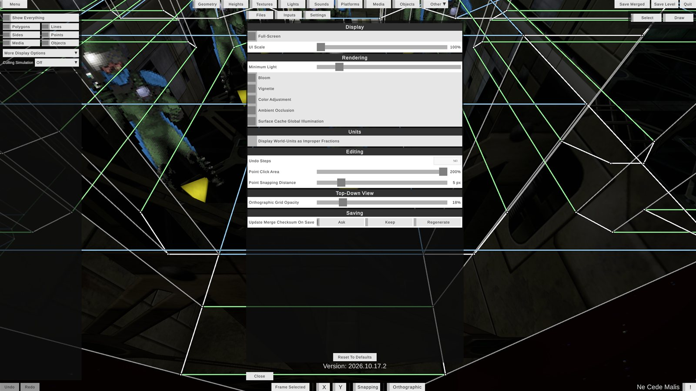

The **Files** tab of the Menu loads your scenario's data:

- **Maps**, **Shapes**, **Physics** and **Sounds:** pick each with **Select**, or clear it with **Unload**. Forge+ recognizes Marathon 2 and Infinity files, and Marathon 1 files. It reads MacBinary, AppleSingle and resource-fork files.
- **Plugins** and **Scripts** folders *(Aleph One only)*.
- **Find In Directory:** pick a folder, and Forge+ finds the first file of each type in it (shallowest folders first), plus the Plugins and Scripts folders.
- **Level list** and **Load Level:** the only way to open a level.
- **New Map:** creates a new map file. Choose where to save it, then name its first level (a map file needs at least one). The new map is saved right away and opened in place of the loaded one, so the open level's unsaved edits are discarded. It's saved as Marathon 2 data, which the original games can read.
- **New Level** (below the level list): adds a new level to the end of the loaded map file, named in a dialog, and selects it ready to load. The map file is saved right away, with its other levels as they were last saved, so the open level's unsaved edits stay unsaved. The map's checksum changes. Grayed out while no map file is loaded.

New levels start the way Forge and Weland start them: set up for single player, with a small starting room, a player start, and a set of lights from full intensity down to none in steps of 5%.

> [!CAUTION]
> Opening another level, or quitting, **discards unsaved edits without asking**. Save first.

**Plugins and MML:** Forge+ applies a scenario's MML (from its Scripts folder) and its Aleph One plugins the way Aleph One does, so levels show the textures, sprites and sounds they would in the game.

- Turn plugins on and off in the **Plugins** dropdown, as in Aleph One's Plugins menu. Forge+ remembers each one. Plugins that aren't for this scenario are grayed out, and overridden ones are marked *(not in use)*. Turning a plugin on or off reloads the open level, and your unsaved edits are kept.
- A level's own MML (from its level script, and MML saved in it) applies as it's opened.
- MML that changes what Forge+ shows is applied: item, scenery and player shapes, liquids, control panels, platform, ambient and random sounds, and substitute images for walls and sprites (normal images and masks, as `.png`, `.jpg` or `.dds`: DXT1, DXT3, DXT5, or uncompressed).

## Saving

| Button | What it saves |
|---|---|
| **Save Merged** | Every level in the map file, with your edits, into one file. You choose to **Keep** the map's checksum (so saved games, films and physics files still find the map) or **Regenerate** it. Tick *Remember my choice* to skip that question next time (or set it in Settings) |
| **Save Level** | Only the open level, as its own map file. You choose whether to include its **Physics**, its **Resources** (chapter screen, terminal pictures, its part of the level script and the end screens), both, or neither |

After saving, the saved file becomes the loaded Maps file. Forge+ always saves in the Marathon Infinity file format, including when the input was a Marathon 1 map.

## Compatibility: Marathon 2, Infinity and Aleph One

Forge+ aims for every file it saves to load in the original **Marathon 2** and **Marathon Infinity**:

- Data only Aleph One understands is saved only when you actually use it. Aleph One stores this kind of data as extensions, which the original games ignore.
- Anything that would only work in Aleph One is labeled **Aleph One only** in the interface, with an orange marker. For example: sound entries past 64, textures from other environments' collections, some transfer modes, media types and control panel types, decorative lines, some control panel flags, Marathon 1 flags, and the random and fluorescent light styles.
- Aleph One data that Forge+ can't edit yet (shape and sound patches, MML, Lua, the map's level script) is kept and saved exactly as it was.

## Settings

The **Settings** tab of the Menu is grouped into sections:

| Section | Setting | Default | What it does |
|---|---|---|---|
| **Display** | Full-Screen | On | Runs Forge+ full-screen |
| | UI Scale | 100% | How large the interface is drawn (100–350%, in steps of 50%), for high-resolution screens. It's applied once you let go of the slider |
| **Rendering** | Minimum Light | Low | The lowest light level surfaces are drawn with, so dark areas stay visible |
| | Bloom, Vignette, Color Adjustment, Ambient Occlusion | On | Visual effects in the view |
| | Surface Cache Global Illumination | Off | Higher-quality light bouncing |
| **Units** | Display World-Units as Improper Fractions | Off | Shows `-512/1024` instead of `-1 and 512/1024` |
| **Editing** | Undo Steps | 50 | How many changes you can undo (1–10,000) |
| | Point Click Area | 100% | How large points' clickable area is (100–200%) |
| | Point Snapping Distance | 5 px | How close the pointer must be to snap a new line onto an existing point |
| **Top-Down View** | Orthographic Grid Opacity | 40% | How visible the top-down grid is |
| **Saving** | Update Merge Checksum On Save | Ask | Whether Save Merged keeps or regenerates the checksum, or asks each time |

**Reset To Defaults** resets these settings and the display options, but keeps your file paths. The bottom of the tab shows the version of Forge+ you're running, which is handy when reporting bugs.

---

## Input reference

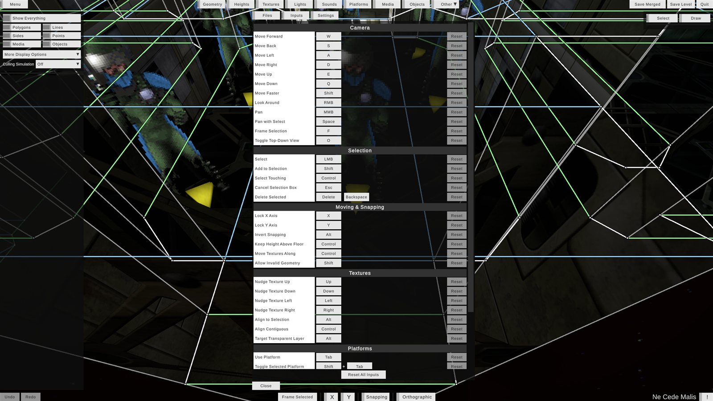

Every binding can be changed in the **Inputs** tab of the Menu. Click a binding, then press the new key or button (<kbd>Esc</kbd> cancels). Each binding has its own **Reset** button, and there's also **Reset All Inputs**. Conflicting bindings are flagged. These are the defaults:

<strong>Camera</strong>

| Action | Default |
|---|---|
| Move forward / back / left / right | <kbd>W</kbd> / <kbd>S</kbd> / <kbd>A</kbd> / <kbd>D</kbd> |
| Move up / down | <kbd>E</kbd> / <kbd>Q</kbd> |
| Move faster | <kbd>Shift</kbd> |
| Look around | Right mouse |
| Pan | Middle mouse |
| Pan with Select | <kbd>Space</kbd> + left mouse |
| Move / zoom | Mouse wheel |
| Frame selection | <kbd>F</kbd> |
| Toggle top-down view | <kbd>O</kbd> |

<strong>Selection</strong>

| Action | Default |
|---|---|
| Select | Left mouse |
| Add to selection | <kbd>Shift</kbd> |
| Select touching (rectangle) | <kbd>Ctrl</kbd> / <kbd>Cmd</kbd> |
| Cancel selection box | <kbd>Esc</kbd> |
| Delete selected (what it does depends on the mode) | <kbd>Delete</kbd>, <kbd>Backspace</kbd> |

<strong>Moving and snapping</strong>

| Action | Default |
|---|---|
| Lock X axis / Lock Y axis | <kbd>X</kbd> / <kbd>Y</kbd> |
| Invert snapping | <kbd>Alt</kbd> / <kbd>Option</kbd> |
| Keep height above floor (dragging objects) | <kbd>Ctrl</kbd> |
| Move textures along (dragging geometry) | <kbd>Ctrl</kbd> |
| Allow invalid geometry | <kbd>Shift</kbd> |

<strong>Textures</strong>

| Action | Default |
|---|---|
| Nudge texture | Arrow keys |
| Align to selection | <kbd>Alt</kbd> + click |
| Align contiguous textures | <kbd>Ctrl</kbd> (while dragging or nudging) |
| Target the transparent layer | <kbd>Alt</kbd> (as a wall drag starts) |

<strong>Platforms</strong>

| Action | Default |
|---|---|
| Use platform (in front of the camera) | <kbd>Tab</kbd> |
| Toggle selected platforms | <kbd>Shift</kbd>+<kbd>Tab</kbd> |
| Obstruct selected platforms | <kbd>Ctrl</kbd>+<kbd>Tab</kbd> |

<strong>Interface</strong>

| Action | Default |
|---|---|
| Open / close the menu | <kbd>Esc</kbd> |
| Show / hide the interface | <kbd>`</kbd> |
| Undo | <kbd>Ctrl</kbd>+<kbd>Z</kbd> / <kbd>Cmd</kbd>+<kbd>Z</kbd> |
| Redo | <kbd>Ctrl</kbd>+<kbd>Y</kbd>, <kbd>Ctrl</kbd>+<kbd>Shift</kbd>+<kbd>Z</kbd> / <kbd>Cmd</kbd>+<kbd>Shift</kbd>+<kbd>Z</kbd> |

Keyboard shortcuts don't fire while you're typing in a field.

---

## Tips and tricks

- **Hover for help.** Every field, button and tab has a tooltip, and grayed-out fields usually say why they're unavailable.
- **Use the top-down view for layout work.** Press <kbd>O</kbd> to drop into a classic overhead view, with a grid (**More Display Options → Grid**). Press it again to return to 3D, tilted toward your last selection.
- **Switch modes without losing your place.** Select a polygon in Geometry mode, then switch to Textures, Lights, Media, Platforms or Sounds, and the matching item is already selected.
- **Build rooms fast with the Draw tool:** extrude a wall into a new polygon, keep extruding to make a corridor, and draw lines between corners to split rooms. Close a loop of lines and Forge+ fills it in for you. You can also sketch a room's outline from empty space and double-click its cyan floor to fill it.
- **Keep textures aligned while reshaping.** Hold <kbd>Ctrl</kbd> while dragging points or lines. When aligning textures, <kbd>Ctrl</kbd>-drag moves a whole run of matching walls at once.
- **Copy alignment.** In Textures mode, select a well-aligned surface and <kbd>Alt</kbd>+click its neighbors to line them up with it.
- **Test doors in place.** Fly up to a door and press <kbd>Tab</kbd>, or select a platform and press <kbd>Shift</kbd>+<kbd>Tab</kbd>.
- **Use the selection rectangle precisely.** It normally selects only what's wholly inside it. Hold <kbd>Ctrl</kbd> to select anything it touches.
- **Hide clutter.** Turn off Objects, Media or Sides to click through to what's behind them, or press <kbd>`</kbd> to hide the interface for a clean view (or a screenshot).
- **Scrub numbers.** Drag a field's label instead of typing, and hold <kbd>Alt</kbd> to toggle snapping while you do.
- **Check the !** before saving, and use **Fix All** for problems Forge+ can repair itself.
- **Diagnose odd geometry** with **Diagnostic Visuals** (concave polygons in red) and **Simple Visuals** (plain surfaces).
- **Check sight lines** with **Culling Simulation**. Set it to **Reference Point** and drag the cube into a room to see everything the engine would draw from there, such as whether a window or doorway exposes more of the level than you meant.
- **Hear the level.** Turn on **Play Level Audio**, then fly into a polygon to hear its ambient and random sounds, and the sound sources it hears, as the game would play them.

---

## Known gaps and planned work

Forge+ can view everything in a map, and edit much of it. These are the main things it can't do yet:

**Creating and deleting**
- [ ] Delete lights, media types or terminals from the level. Today, <kbd>Delete</kbd> only unassigns a light or media from a surface or polygon. Polygons, lines, points, objects, annotations, sound entries and terminal groups can be deleted.
- [ ] Place new objects (monsters, items, scenery, player starts, goals, sound sources).
- [ ] Add new lights, media, annotations or terminals. (New maps and levels can be created from the Files tab.)
- [ ] Copy, paste and duplicate geometry or objects.

**Editing**
- [ ] Edit more than one thing at a time in the inspector (multi-selection currently only supports moving).
- [ ] Edit a line's transparency, a side's type, or an annotation's type directly. These follow from other settings.
- [ ] Edit terminal Lines Per Page.
- [ ] Edit Aleph One extension data: shape patches, sound patches, embedded MML, Lua and the map's level script. (These are preserved, not lost.)
- [ ] Edit map header details other than the name, and the Mac resource fork.
- [ ] Edit physics, shapes and sounds files. These are loaded for display and preview only, and embedded physics is carried through on save.

**Workflow**
- [ ] Warn about unsaved changes when quitting or opening another level.
- [ ] Keyboard shortcuts for switching modes and toggling visibility.
- [ ] Culling Simulation trimming overlapping polygons ("5-D space").
- [ ] Loading an **Images** file.
- [ ] Optionally opening the first level automatically when a Maps file is chosen.
- [ ] Saving a Marathon 1 map as Marathon 1 data (Marathon 1 input is always saved in the modern format).

---

## Building Forge+ yourself

1. Install Unity (from [unity.com](https://unity.com)), at or above the version in [`ProjectSettings/ProjectVersion.txt`](ProjectSettings/ProjectVersion.txt). The free Unity Personal license is fine.
2. Include the build support module for each platform you want to build for. Forge+ is presently tested with:
   - Windows (CoreCLR)
   - Linux (IL2CPP)
   - Mac (Mono)
3. In Unity, open the root of this repository. It's the root of the Unity project.
4. Build as usual: **File → Build Settings...**, choose the target platform, then **Build** or **Build And Run**.

## License

See [LICENSE](LICENSE).
